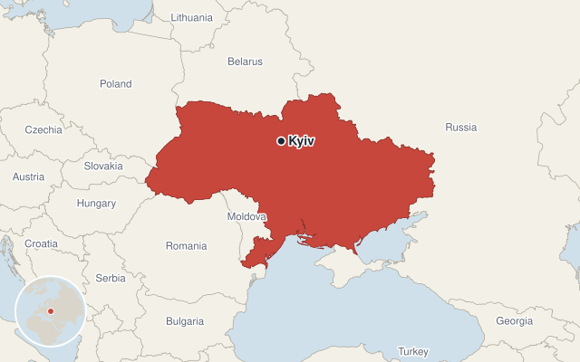

---
id    = "c1511314-ecce-5692-bb60-c1f2a99aa84f"
model = "Basic"
tags  = ["europe", "sovereign_state", "capital"]
---

## Front

What is the capital of <b>Ukraine</b>?

## Back

<b>Kyiv</b>

## Extra

Also known as Kiev.

<a href="https://en.wikipedia.org/wiki/Kyiv">Kyiv on Wikipedia</a> <a href="https://en.wikipedia.org/wiki/Ukraine">Ukraine on Wikipedia</a>
