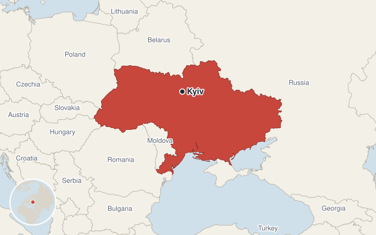

---
id    = "83948d39-ca08-55fa-90fc-88543e296561"
model = "Basic"
tags  = ["europe", "sovereign_state", "country"]
---

## Front

<b>Kyiv</b> is the capital of which country or territory?

## Back

<b>Ukraine</b>

## Extra

About 41 million people (2022) in 603,550 km² Second-largest country in Europe after Russia

Kievan Rus', which emerged in the 9th century, became the largest and most powerful realm in Europe in the 10th and 11th centuries.

Also known as Kiev.

<a href="https://en.wikipedia.org/wiki/Ukraine">Ukraine on Wikipedia</a> <a href="https://en.wikipedia.org/wiki/Kyiv">Kyiv on Wikipedia</a>
