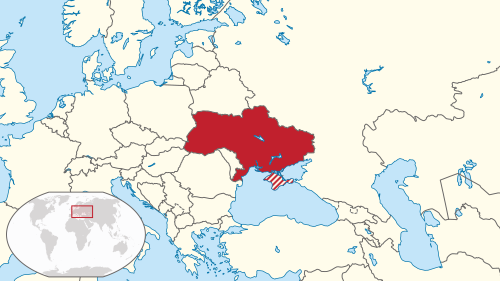
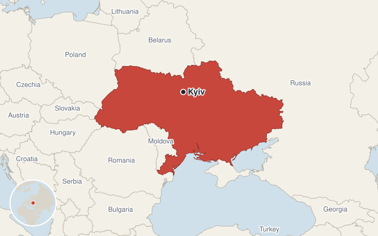

---
id    = "75305958-5155-5547-ae96-3ecc1d8f63ff"
model = "Basic"
tags  = ["europe", "sovereign_state", "map"]
---

## Front

What is highlighted on this map?

## Back

<b>Ukraine</b>

## Extra

Borders Russia, Belarus, Poland, Slovakia, Hungary, Romania and Moldova Highest point: Hoverla

The Black Sea and the Sea of Azov lie along its south and southeast.

<a href="https://en.wikipedia.org/wiki/Ukraine">Ukraine on Wikipedia</a>
