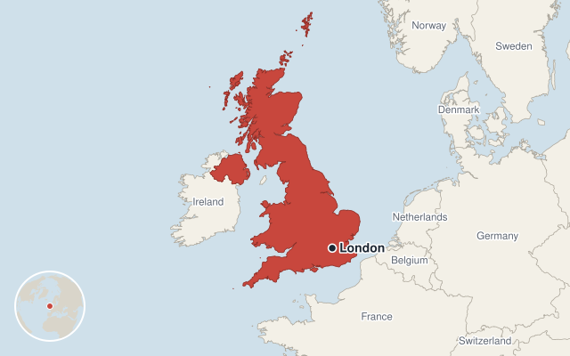

---
id    = "de7511b3-e753-536f-9502-64c6447ee3a3"
model = "Basic"
tags  = ["europe", "sovereign_state", "capital"]
---

## Front

What is the capital of <b>United Kingdom</b>?

<i>Sovereign country</i>

## Back

<b>London</b>

## Extra

<a href="https://en.wikipedia.org/wiki/London">London on Wikipedia</a> <a href="https://en.wikipedia.org/wiki/United_Kingdom">United Kingdom on Wikipedia</a>
