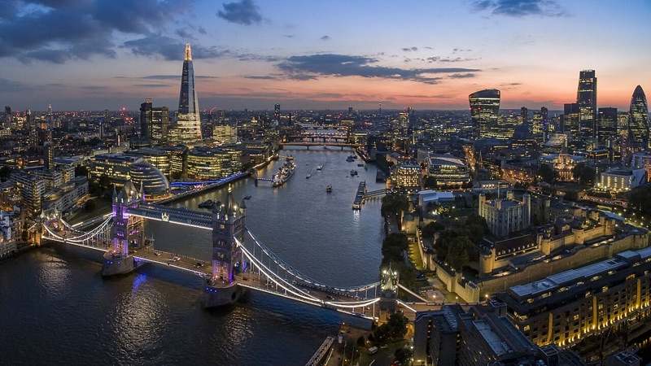

---
id    = "de7511b3-e753-536f-9502-64c6447ee3a3"
model = "Basic"
tags  = ["europe", "sovereign_state", "capital"]
---

## Front

What is the capital of <b>United Kingdom</b>?

<i>Sovereign country</i>

## Back

<b>London</b>

## Extra

<i>Photo: Ilya Grigorik, CC BY-SA 3.0, via Wikimedia Commons</i>

About 8.8 million people (2021) in Greater London On the River Thames, at the head of an 80 km tidal estuary

The Romans founded the City of London as Londinium, and it has kept its medieval boundaries. London has been a major settlement for nearly 2,000 years.

<a href="https://en.wikipedia.org/wiki/London">London on Wikipedia</a> <a href="https://en.wikipedia.org/wiki/United_Kingdom">United Kingdom on Wikipedia</a>
