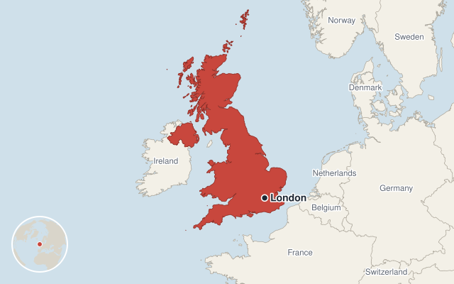

---
id    = "d63acdb6-6bbf-5682-8bf7-be091dbce84d"
model = "Basic"
tags  = ["europe", "sovereign_state", "country"]
---

## Front

<b>London</b> is the capital of which country or territory?

## Back

<b>United Kingdom</b>

## Extra

<a href="https://en.wikipedia.org/wiki/United_Kingdom">United Kingdom on Wikipedia</a> <a href="https://en.wikipedia.org/wiki/London">London on Wikipedia</a>
