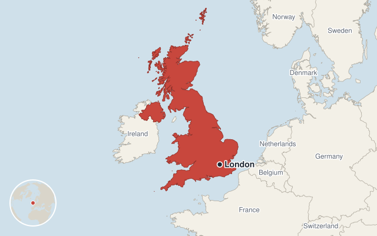

---
id    = "4975f210-cbd8-53e9-a014-1eff3dcce551"
model = "Basic"
tags  = ["europe", "sovereign_state", "flag"]
---

## Front

Whose flag is this?

## Back

<b>United Kingdom</b>

## Extra

<a href="https://en.wikipedia.org/wiki/Union_Jack">Union Jack on Wikipedia</a> <a href="https://en.wikipedia.org/wiki/United_Kingdom">United Kingdom on Wikipedia</a>
