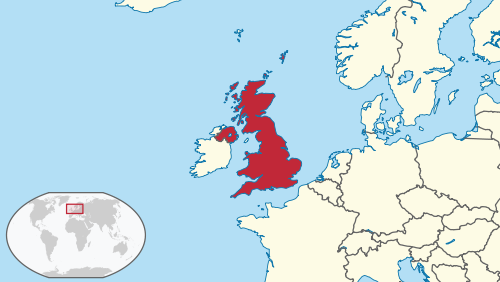
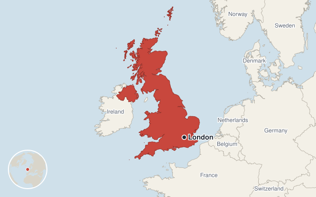

---
id    = "82edb4a5-8178-5ca6-86b3-83e770b8ffc5"
model = "Basic"
tags  = ["europe", "sovereign_state", "map"]
---

## Front

What is highlighted on this map?

## Back

<b>United Kingdom</b>

## Extra

<a href="https://en.wikipedia.org/wiki/United_Kingdom">United Kingdom on Wikipedia</a>
