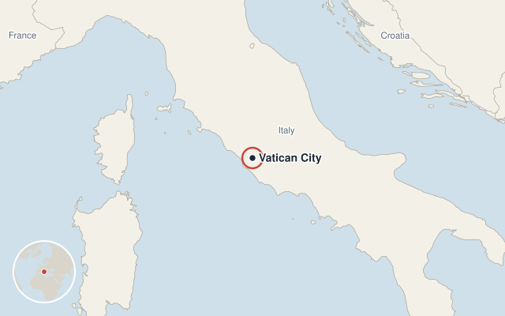

---
id    = "2f3f37dd-851c-55b9-ac60-954d4ec0716b"
model = "Basic"
tags  = ["europe", "sovereign_state", "capital"]
---

## Front

What is the capital of <b>Vatican City</b>?

## Back

<b>Vatican City</b>

## Extra

About 950 people (2024) An enclave within the city of Rome

The city and the country are the same place: a sovereign city-state ruled by the pope. It is a World Heritage Site that includes St Peter's Basilica.

<a href="https://en.wikipedia.org/wiki/Vatican_City">Vatican City on Wikipedia</a>
