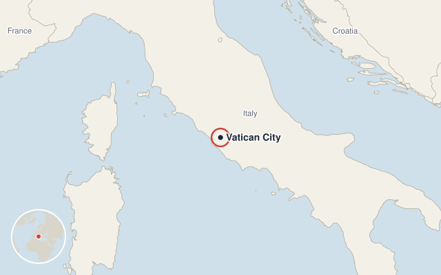

---
id    = "54239c51-fd74-5e71-8262-bda034a0a5ea"
model = "Basic"
tags  = ["europe", "sovereign_state", "country"]
---

## Front

<b>Vatican City</b> is the capital of which country or territory?

## Back

<b>Vatican City</b>

## Extra

Smallest country by area and least populous Official languages: Latin and Italian

An absolute monarchy under the pope, who is elected by the College of Cardinals. The modern state was established by the Lateran Treaty of 1929.

<a href="https://en.wikipedia.org/wiki/Vatican_City">Vatican City on Wikipedia</a>
