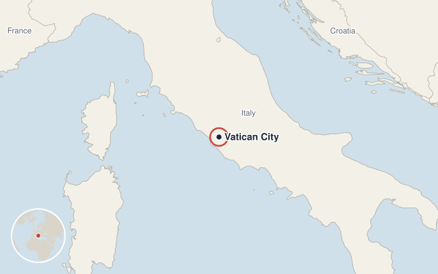

---
id    = "c7ebab0b-bf25-5e4e-b1c0-5b0020e77c52"
model = "Basic"
tags  = ["europe", "sovereign_state", "flag"]
---

## Front

Whose flag is this?

## Back

<b>Vatican City</b>

## Extra

Adopted on 7 June 1929

Yellow and white, with the papal tiara and the crossed keys of Saint Peter. It is one of only two national flags that are square, along with Switzerland's.

<a href="https://en.wikipedia.org/wiki/Flag_of_Vatican_City">Flag of Vatican City on Wikipedia</a> <a href="https://en.wikipedia.org/wiki/Vatican_City">Vatican City on Wikipedia</a>
