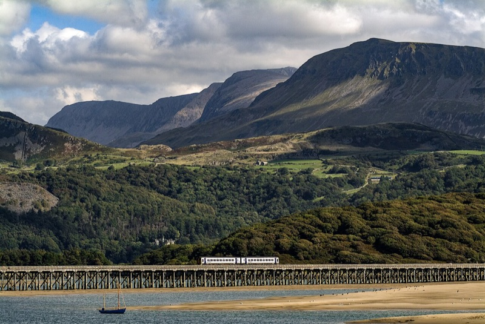

---
id    = "982d5a61-1927-5878-96c8-be8182882c42"
model = "Basic"
tags  = ["europe", "country"]
---

## Front

<b>Cardiff</b> is the capital of which country or territory?

## Back

<b>Wales</b>

## Extra

<i>Photo: Themountainphotographer, CC BY-SA 4.0, via Wikimedia Commons</i>

About 3.1 million people (2021) Highest point: Snowdon

Two-thirds of the population live in South Wales, around Cardiff, Swansea and Newport. The Senedd, the Welsh Parliament, was formed in 1998 and handles devolved policy.

Constituent country of the United Kingdom.

<a href="https://en.wikipedia.org/wiki/Wales">Wales on Wikipedia</a> <a href="https://en.wikipedia.org/wiki/Cardiff">Cardiff on Wikipedia</a>
