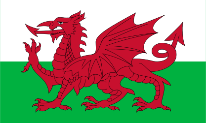

---
id    = "8ec91d4e-c442-5412-b094-1b0da2de8112"
model = "Basic"
tags  = ["europe", "flag"]
---

## Front

Whose flag is this?

## Back

<b>Wales</b>

## Extra

Officially recognised as the Welsh national flag in 1959

A red dragon on a green and white field. Green and white are the Tudor colours, and Henry VII carried a red dragon standard at the Battle of Bosworth in 1485.

Constituent country of the United Kingdom.

<a href="https://en.wikipedia.org/wiki/Flag_of_Wales">Flag of Wales on Wikipedia</a> <a href="https://en.wikipedia.org/wiki/Wales">Wales on Wikipedia</a>
