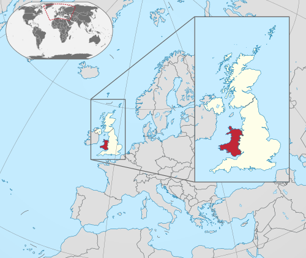

---
id    = "bf82c360-ec33-56c5-954c-ef1b5e14f232"
model = "Basic"
tags  = ["europe", "map"]
---

## Front

What is highlighted on this map?

## Back

<b>Wales</b>

## Extra

Borders only England, with sea on every other side Area 21,218 km², with over 2,700 km of coastline

Largely mountainous, with the higher peaks in the north and centre. The Irish Sea lies to the north and west, the Bristol Channel to the south and the Celtic Sea to the south-west.

Constituent country of the United Kingdom.

<a href="https://en.wikipedia.org/wiki/Wales">Wales on Wikipedia</a>
