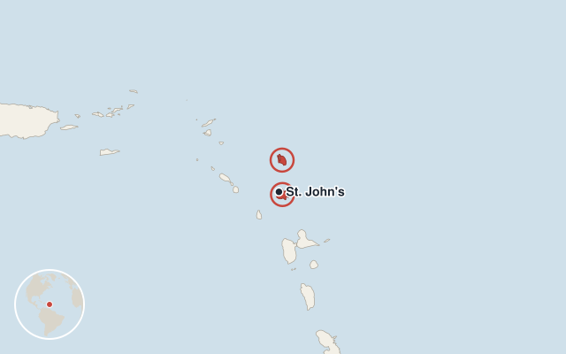

---
id    = "9f0de3a5-7ed4-51c4-9c6a-12df80451056"
model = "Basic"
tags  = ["caribbean", "north_america", "sovereign_state", "capital"]
---

## Front

What is the capital of <b>Antigua and Barbuda</b>?

## Back

<b>St. John's</b>

## Extra

About 21,000 people (2025), the country's largest city On St. John's Harbour, in the west of Antigua

It was laid out after a French invasion in 1666, chosen for its strategic harbour. It later overtook Falmouth as the island's dominant town.

<a href="https://en.wikipedia.org/wiki/St._John's,_Antigua_and_Barbuda">St. John's, Antigua and Barbuda on Wikipedia</a> <a href="https://en.wikipedia.org/wiki/Antigua_and_Barbuda">Antigua and Barbuda on Wikipedia</a>
