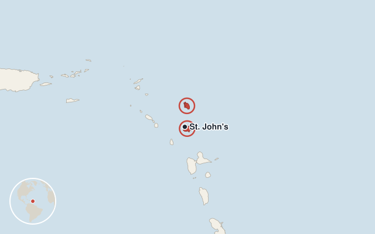
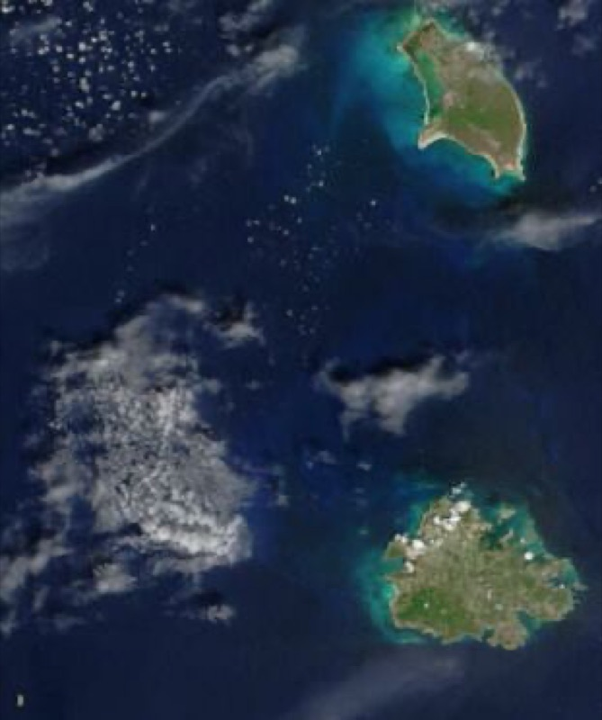

---
id    = "dcb0b73e-9d4a-579f-94da-1f7b97388962"
model = "Basic"
tags  = ["caribbean", "north_america", "sovereign_state", "country"]
---

## Front

<b>St. John's</b> is the capital of which country or territory?

## Back

<b>Antigua and Barbuda</b>

## Extra

<i>Photo: Jacques Descloitres, MODIS Rapid Response Team, NASA/GSFC, Public domain, via Wikimedia Commons</i>

About 101,000 people (2023) in 440 km² A country of two main islands, Antigua and Barbuda

One of the smallest countries in the Caribbean. Columbus surveyed Antigua in 1493, and the first successful British colony was founded in 1632.

<a href="https://en.wikipedia.org/wiki/Antigua_and_Barbuda">Antigua and Barbuda on Wikipedia</a> <a href="https://en.wikipedia.org/wiki/St._John's,_Antigua_and_Barbuda">St. John's, Antigua and Barbuda on Wikipedia</a>
