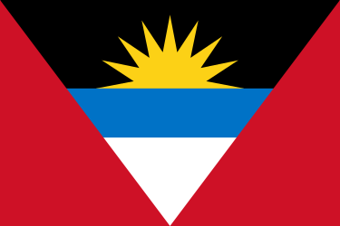

---
id    = "a918ab52-a44b-5895-b827-4549f01c16e3"
model = "Basic"
tags  = ["caribbean", "north_america", "sovereign_state", "flag"]
---

## Front

Whose flag is this?

## Back

<b>Antigua and Barbuda</b>
