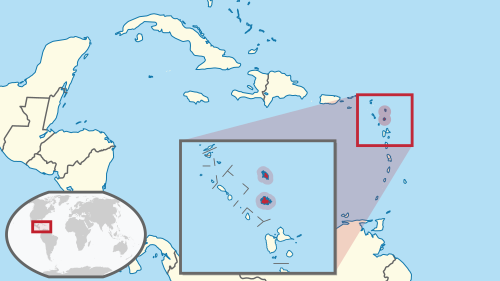
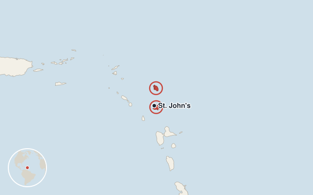

---
id    = "5becb2f5-e829-5dd6-9c80-c9aafd2c16ff"
model = "Basic"
tags  = ["caribbean", "north_america", "sovereign_state", "map"]
---

## Front

What is highlighted on this map?

## Back

<b>Antigua and Barbuda</b>

## Extra

Sea borders with Saint Kitts and Nevis, Montserrat and Guadeloupe Antigua, Barbuda and dozens of smaller islands

Mostly flat, with the Atlantic Ocean to the east and the Caribbean Sea to the west. Barbuda has just one settlement, Codrington.

<a href="https://en.wikipedia.org/wiki/Antigua_and_Barbuda">Antigua and Barbuda on Wikipedia</a>
