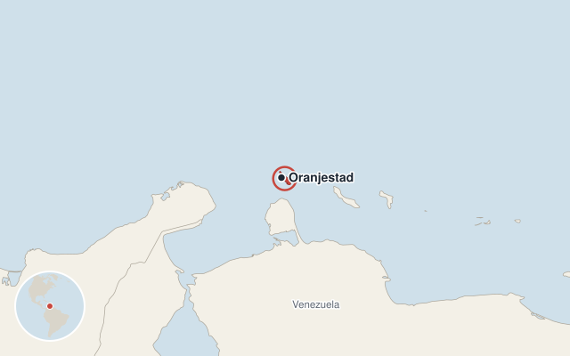

---
id    = "1bc2fe10-8da1-5b1d-b8c8-5fcaa43df1b3"
model = "Basic"
tags  = ["caribbean", "north_america", "capital"]
---

## Front

What is the capital of <b>Aruba</b>?

## Back

<b>Oranjestad</b>

## Extra

Constituent country of the Kingdom of the Netherlands.

<a href="https://en.wikipedia.org/wiki/Oranjestad">Oranjestad on Wikipedia</a> <a href="https://en.wikipedia.org/wiki/Aruba">Aruba on Wikipedia</a>
