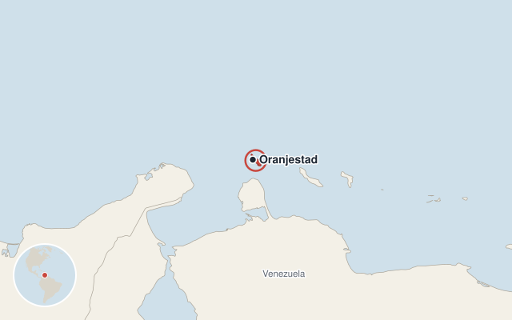

---
id    = "07ac3a7e-90c7-58f2-8156-ac1bdd4b29fa"
model = "Basic"
tags  = ["caribbean", "north_america", "country"]
---

## Front

<b>Oranjestad</b> is the capital of which country or territory?

## Back

<b>Aruba</b>

## Extra

Constituent country of the Kingdom of the Netherlands.

<a href="https://en.wikipedia.org/wiki/Aruba">Aruba on Wikipedia</a> <a href="https://en.wikipedia.org/wiki/Oranjestad">Oranjestad on Wikipedia</a>
