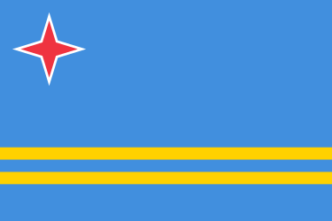
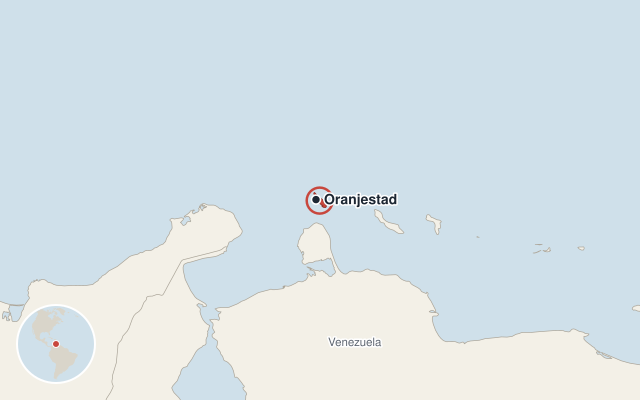

---
id    = "0a7990ca-7edb-5bee-81fd-d0e6f40a6f64"
model = "Basic"
tags  = ["caribbean", "north_america", "flag"]
---

## Front

Whose flag is this?

## Back

<b>Aruba</b>

## Extra

Adopted on 18 March 1976, together with the national anthem

The red four-pointed star stands for the points of the compass and the varied origins of Aruba's people. Blue is the sea around the island, and white its beaches.

Constituent country of the Kingdom of the Netherlands.

<a href="https://en.wikipedia.org/wiki/Flag_of_Aruba">Flag of Aruba on Wikipedia</a> <a href="https://en.wikipedia.org/wiki/Aruba">Aruba on Wikipedia</a>
