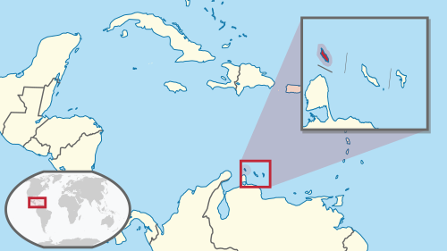

---
id    = "77543e6c-97cf-5815-be71-ec8ef273dd20"
model = "Basic"
tags  = ["caribbean", "north_america", "map"]
---

## Front

What is highlighted on this map?

## Back

<b>Aruba</b>

## Extra

Constituent country of the Kingdom of the Netherlands.

<a href="https://en.wikipedia.org/wiki/Aruba">Aruba on Wikipedia</a>
