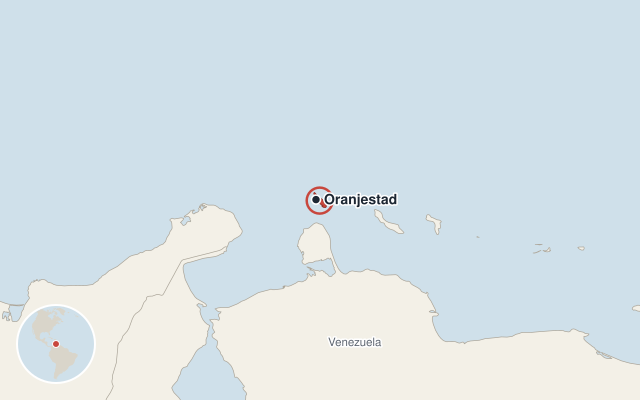
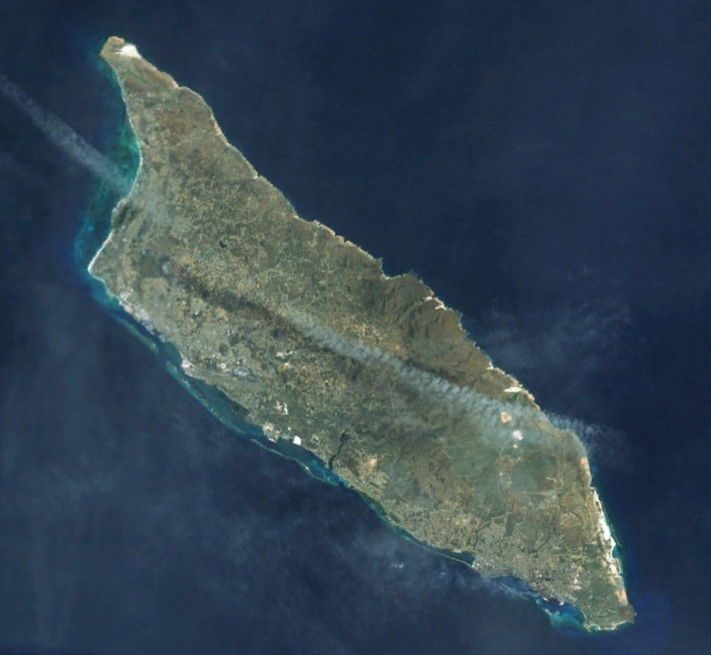

---
id    = "77543e6c-97cf-5815-be71-ec8ef273dd20"
model = "Basic"
tags  = ["caribbean", "north_america", "map"]
---

## Front

What is highlighted on this map?

## Back

<b>Aruba</b>

## Extra

<i>Photo: NASA World Wind, Screenshot by Carport, Public domain, via Wikimedia Commons</i>

29 km north of Venezuela's Paraguaná peninsula, and 80 km north-west of Curaçao 32 km long and 10 km across at its widest

Geologically Aruba lies in South America, on the continental shelf. With Bonaire and Curaçao it forms the ABC islands.

Constituent country of the Kingdom of the Netherlands.

<a href="https://en.wikipedia.org/wiki/Aruba">Aruba on Wikipedia</a>
