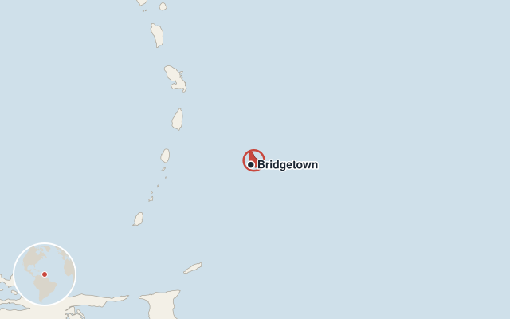
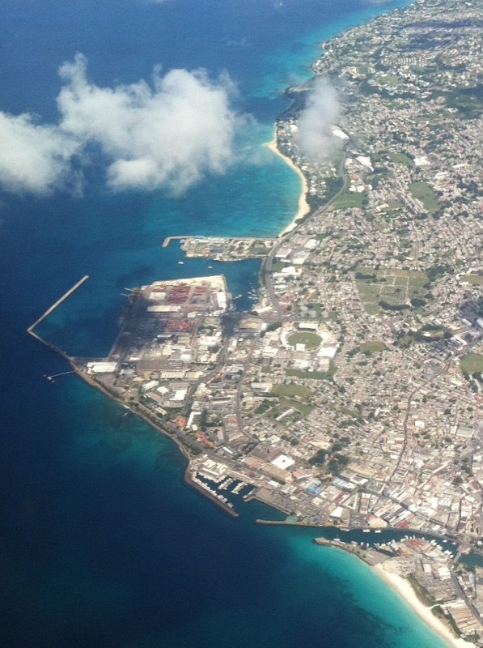

---
id    = "4fdd5a85-2ef8-52cf-8d4b-a526af29423c"
model = "Basic"
tags  = ["caribbean", "north_america", "sovereign_state", "capital"]
---

## Front

What is the capital of <b>Barbados</b>?

## Back

<b>Bridgetown</b>

## Extra

<i>Photo: P.Lechien, CC0, via Wikimedia Commons</i>

About 98,500 people (2025) On Carlisle Bay, on the island's southwestern coast

English settlers found a bridge over the Careenage swamp and called the area Indian Bridge. Bridgetown is the only city outside the United States that George Washington visited.

<a href="https://en.wikipedia.org/wiki/Bridgetown">Bridgetown on Wikipedia</a> <a href="https://en.wikipedia.org/wiki/Barbados">Barbados on Wikipedia</a>
