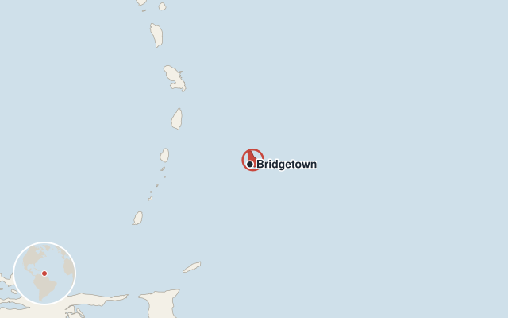

---
id    = "bfd25101-52dc-54c3-9cc3-a254ff7daca6"
model = "Basic"
tags  = ["caribbean", "north_america", "sovereign_state", "country"]
---

## Front

<b>Bridgetown</b> is the capital of which country or territory?

## Back

<b>Barbados</b>

## Extra

<a href="https://en.wikipedia.org/wiki/Barbados">Barbados on Wikipedia</a> <a href="https://en.wikipedia.org/wiki/Bridgetown">Bridgetown on Wikipedia</a>
