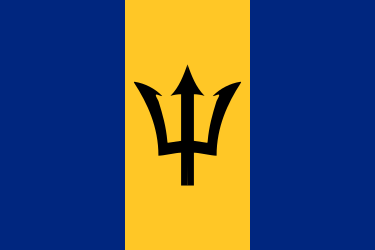
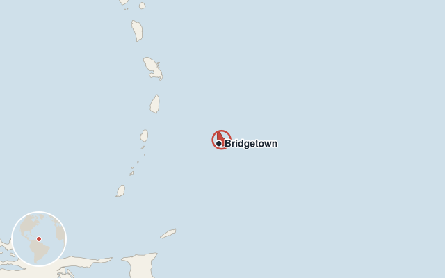

---
id    = "57e4a6a1-5b04-53b0-9cae-b7ea7899aa73"
model = "Basic"
tags  = ["caribbean", "north_america", "sovereign_state", "flag"]
---

## Front

Whose flag is this?

## Back

<b>Barbados</b>

## Extra

<a href="https://en.wikipedia.org/wiki/Flag_of_Barbados">Flag of Barbados on Wikipedia</a> <a href="https://en.wikipedia.org/wiki/Barbados">Barbados on Wikipedia</a>
