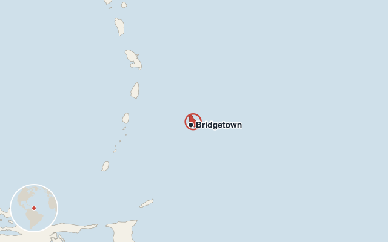

---
id    = "f14d0e6a-aa01-5a99-9d31-8f1005a69c61"
model = "Basic"
tags  = ["caribbean", "north_america", "sovereign_state", "map"]
---

## Front

What is highlighted on this map?

## Back

<b>Barbados</b>

## Extra

<a href="https://en.wikipedia.org/wiki/Barbados">Barbados on Wikipedia</a>
