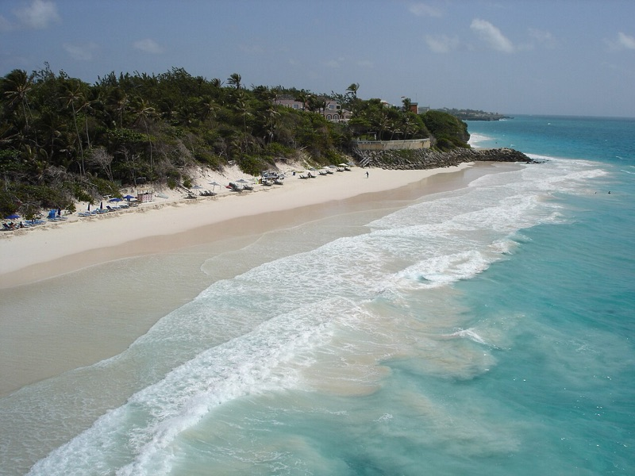

---
id    = "f14d0e6a-aa01-5a99-9d31-8f1005a69c61"
model = "Basic"
tags  = ["caribbean", "north_america", "sovereign_state", "map"]
---

## Front

What is highlighted on this map?

## Back

<b>Barbados</b>

## Extra

<i>Photo: Patdoy at en.wikipedia, CC BY-SA 3.0, via Wikimedia Commons</i>

34 km long and up to 23 km wide 168 km east of Saint Lucia and Saint Vincent and the Grenadines

The easternmost island of the Lesser Antilles, set apart in the Atlantic. It is flat compared with the Windward Islands to its west, rising gently to the central Scotland District.

<a href="https://en.wikipedia.org/wiki/Barbados">Barbados on Wikipedia</a>
