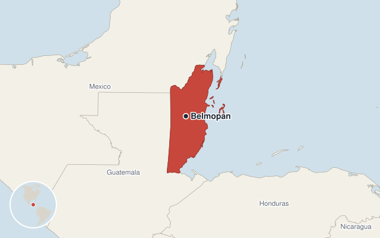
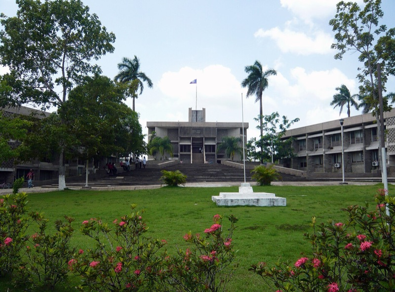

---
id    = "86891071-f78b-5b7c-ab0c-24a4b3b15414"
model = "Basic"
tags  = ["north_america", "sovereign_state", "capital"]
---

## Front

What is the capital of <b>Belize</b>?

## Back

<b>Belmopan</b>

## Extra

<i>Photo: Haakon S. Krohn, CC BY-SA 3.0, via Wikimedia Commons</i>

About 20,800 people (2022), the smallest capital in the continental Americas 76 m above sea level, inland on the Belize River

A planned city, built after Hurricane Hattie in 1961 nearly destroyed coastal Belize City. The government moved here in 1970, and its name joins "Belize" and "Mopan", two rivers.

<a href="https://en.wikipedia.org/wiki/Belmopan">Belmopan on Wikipedia</a> <a href="https://en.wikipedia.org/wiki/Belize">Belize on Wikipedia</a>
