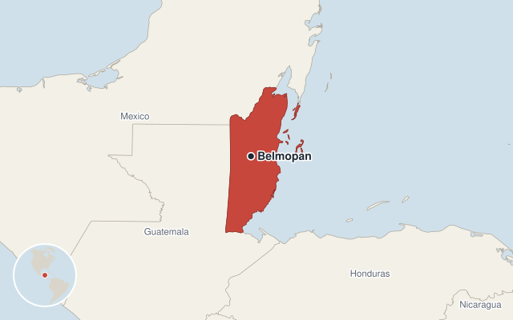

---
id    = "1c5543d1-35e8-537e-bc2d-1e83eedb90a7"
model = "Basic"
tags  = ["north_america", "sovereign_state", "country"]
---

## Front

<b>Belmopan</b> is the capital of which country or territory?

## Back

<b>Belize</b>

## Extra

<a href="https://en.wikipedia.org/wiki/Belize">Belize on Wikipedia</a> <a href="https://en.wikipedia.org/wiki/Belmopan">Belmopan on Wikipedia</a>
