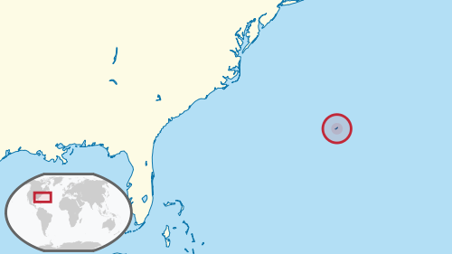
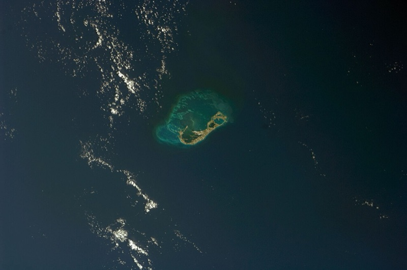

---
id    = "f9005fa5-61d6-5896-8556-ad44fe9ce26f"
model = "Basic"
tags  = ["caribbean", "north_america", "map"]
---

## Front

What is highlighted on this map?

## Back

<b>Bermuda</b>

## Extra

<i>Photo: Earth Science and Remote Sensing Unit, Lyndon B. Johnson Space Center, Public domain, via Wikimedia Commons</i>

Nearest land is North Carolina, about 1,035 km to the west-northwest An archipelago of 181 islands in 54 km² of land

The most significant islands are joined by bridges and appear to form one landmass. A coral reef gives the territory some protection from tropical cyclones.

Overseas territory of the United Kingdom.

<a href="https://en.wikipedia.org/wiki/Bermuda">Bermuda on Wikipedia</a>
