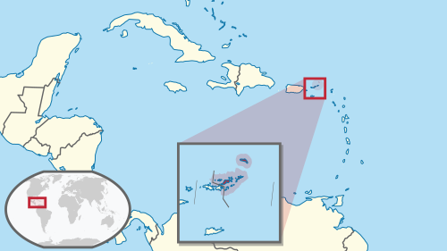

---
id    = "b9525cfe-996f-599d-8cc2-19ab0c503229"
model = "Basic"
tags  = ["caribbean", "north_america", "map"]
---

## Front

What is highlighted on this map?

## Back

<b>British Virgin Islands</b>

## Extra

East of Puerto Rico and the U.S. Virgin Islands, north-west of Anguilla Four main islands: Tortola, Virgin Gorda, Anegada and Jost Van Dyke

More than 50 smaller islands and cays surround them, and about 16 of the islands are inhabited. Tortola, the largest, is about 20 km long and 5 km wide.

Overseas territory of the United Kingdom.

<a href="https://en.wikipedia.org/wiki/British_Virgin_Islands">British Virgin Islands on Wikipedia</a>
