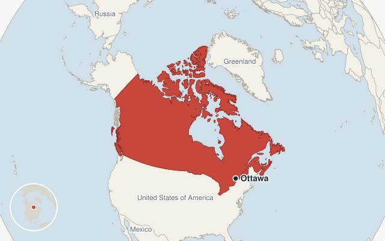

---
id    = "73b8b094-424c-5581-9209-0e7da151eb2b"
model = "Basic"
tags  = ["north_america", "sovereign_state", "capital"]
---

## Front

What is the capital of <b>Canada</b>?

## Back

<b>Ottawa</b>

## Extra

<a href="https://en.wikipedia.org/wiki/Ottawa">Ottawa on Wikipedia</a> <a href="https://en.wikipedia.org/wiki/Canada">Canada on Wikipedia</a>
