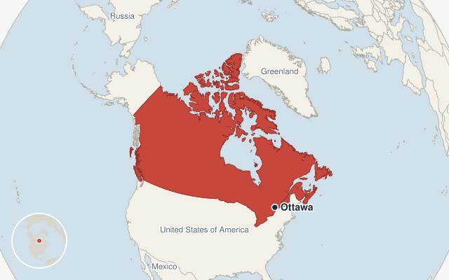

---
id    = "8c8bbdc0-a945-5ebc-bc22-1c2083f3a68c"
model = "Basic"
tags  = ["north_america", "sovereign_state", "country"]
---

## Front

<b>Ottawa</b> is the capital of which country or territory?

## Back

<b>Canada</b>

## Extra

<a href="https://en.wikipedia.org/wiki/Canada">Canada on Wikipedia</a> <a href="https://en.wikipedia.org/wiki/Ottawa">Ottawa on Wikipedia</a>
