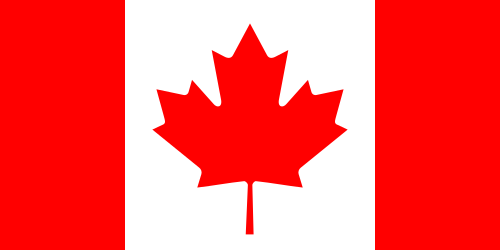
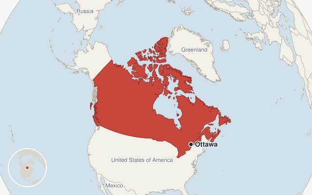

---
id    = "e822a878-858d-5a88-98d9-f67d196866a1"
model = "Basic"
tags  = ["north_america", "sovereign_state", "flag"]
---

## Front

Whose flag is this?

## Back

<b>Canada</b>

## Extra

Adopted on 15 February 1965

The first flag adopted by both houses of Parliament and proclaimed by the monarch. A committee formed in 1964 by Prime Minister Lester B. Pearson began the debate on replacing the Union Flag.

<a href="https://en.wikipedia.org/wiki/Flag_of_Canada">Flag of Canada on Wikipedia</a> <a href="https://en.wikipedia.org/wiki/Canada">Canada on Wikipedia</a>
