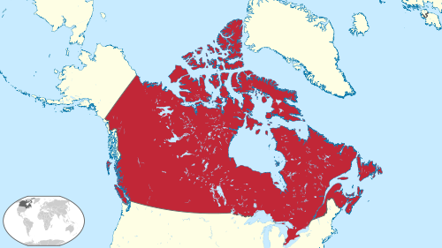
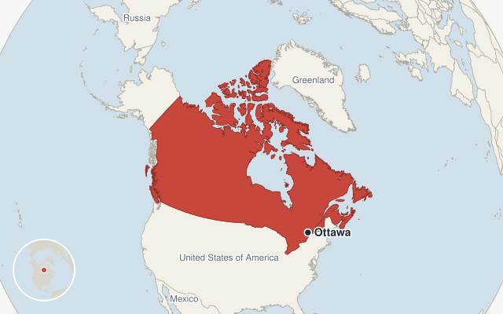

---
id    = "3f069786-a0d5-5861-bea9-099878553c13"
model = "Basic"
tags  = ["north_america", "sovereign_state", "map"]
---

## Front

What is highlighted on this map?

## Back

<b>Canada</b>

## Extra

<a href="https://en.wikipedia.org/wiki/Canada">Canada on Wikipedia</a>
