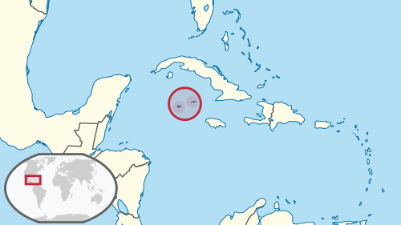

---
id    = "aa112ea6-1462-5ef4-bdad-971cdd9db149"
model = "Basic"
tags  = ["caribbean", "north_america", "map"]
---

## Front

What is highlighted on this map?

## Back

<b>Cayman Islands</b>

## Extra

Overseas territory of the United Kingdom.
