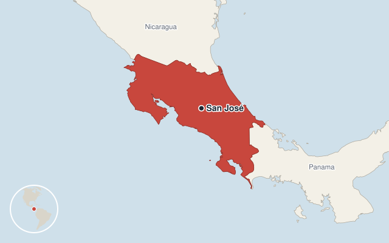
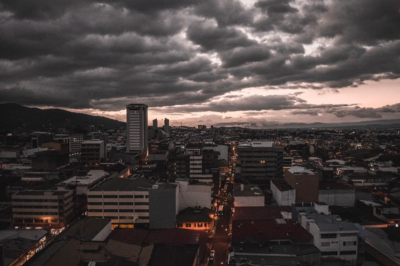

---
id    = "8c377622-754e-5874-8aee-157671937c9e"
model = "Basic"
tags  = ["north_america", "sovereign_state", "capital"]
---

## Front

What is the capital of <b>Costa Rica</b>?

## Back

<b>San José</b>

## Extra

<i>Photo: Xlionheartx, CC BY 3.0, via Wikimedia Commons</i>

About 335,000 people in the city (2025) 1,161 m up, in the Central Valley

The name is Spanish for Saint Joseph. Founded in 1736, it is the seat of national government and a major transport hub.

<a href="https://en.wikipedia.org/wiki/San_Jos%C3%A9,_Costa_Rica">San José, Costa Rica on Wikipedia</a> <a href="https://en.wikipedia.org/wiki/Costa_Rica">Costa Rica on Wikipedia</a>
