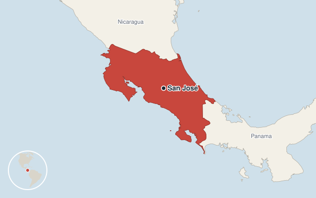

---
id    = "e2818f44-ab9c-5dfa-ad0e-303180c0709b"
model = "Basic"
tags  = ["north_america", "sovereign_state", "country"]
---

## Front

<b>San José</b> is the capital of which country or territory?

## Back

<b>Costa Rica</b>

## Extra

About 5.3 million people (2024) in 51,180 km²

In 1949 a new constitution permanently abolished the army, making Costa Rica one of the few sovereign nations without a standing military.

<a href="https://en.wikipedia.org/wiki/Costa_Rica">Costa Rica on Wikipedia</a> <a href="https://en.wikipedia.org/wiki/San_Jos%C3%A9,_Costa_Rica">San José, Costa Rica on Wikipedia</a>
