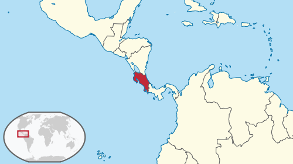
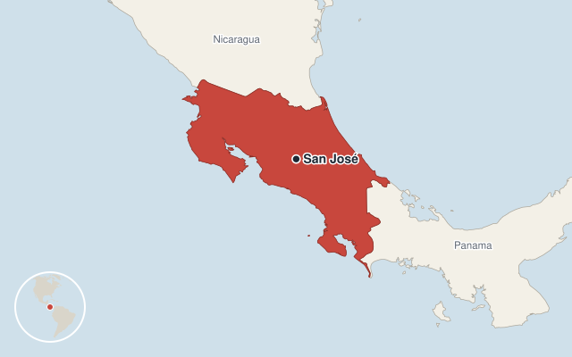

---
id    = "15a36b91-ad78-5c15-adf7-10f525c85336"
model = "Basic"
tags  = ["north_america", "sovereign_state", "map"]
---

## Front

What is highlighted on this map?

## Back

<b>Costa Rica</b>

## Extra

<a href="https://en.wikipedia.org/wiki/Costa_Rica">Costa Rica on Wikipedia</a>
