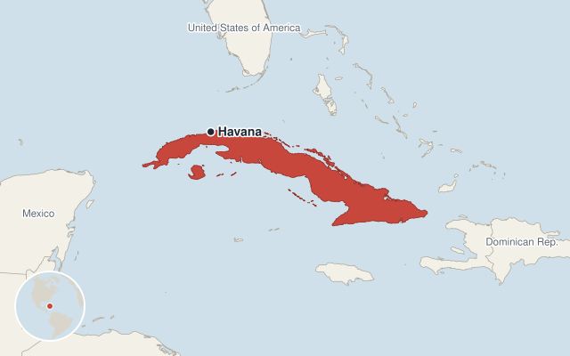

---
id    = "c17bf1cd-6444-5f8c-92c4-b1556cf2b134"
model = "Basic"
tags  = ["caribbean", "north_america", "sovereign_state", "capital"]
---

## Front

What is the capital of <b>Cuba</b>?

## Back

<b>Havana</b>

## Extra

About 2.1 million people in the city (2021) The Caribbean's most populous city

Founded in 1519 by Spain, it overtook Santiago in the mid-16th century thanks to its harbour and became the island's capital in 1552. Walls and forts protected it from naval attack.

<a href="https://en.wikipedia.org/wiki/Havana">Havana on Wikipedia</a> <a href="https://en.wikipedia.org/wiki/Cuba">Cuba on Wikipedia</a>
