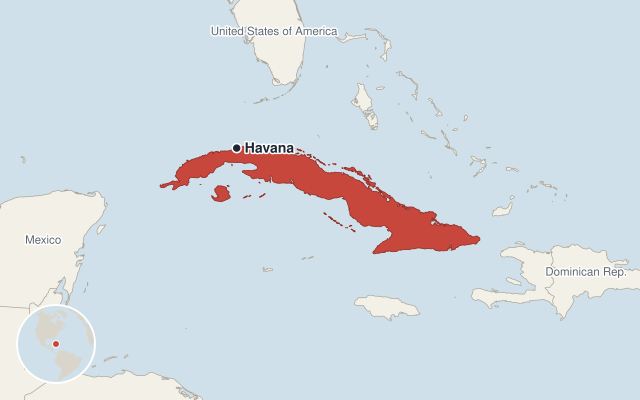

---
id    = "d83ce6b2-5266-56cd-a256-30742244c042"
model = "Basic"
tags  = ["caribbean", "north_america", "sovereign_state", "country"]
---

## Front

<b>Havana</b> is the capital of which country or territory?

## Back

<b>Cuba</b>

## Extra

About 11 million people (2023) in 109,884 km²

The largest country in the Caribbean by area, it consists of the main island and 4,195 islands, islets and cays.

<a href="https://en.wikipedia.org/wiki/Cuba">Cuba on Wikipedia</a> <a href="https://en.wikipedia.org/wiki/Havana">Havana on Wikipedia</a>
