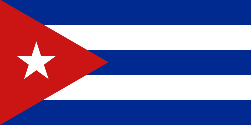

---
id    = "15d2f68b-ec50-5ec8-9a11-65dd3fced602"
model = "Basic"
tags  = ["caribbean", "north_america", "sovereign_state", "flag"]
---

## Front

Whose flag is this?

## Back

<b>Cuba</b>

## Extra

Similar flags: Puerto Rico (blue triangle, red stripes)
