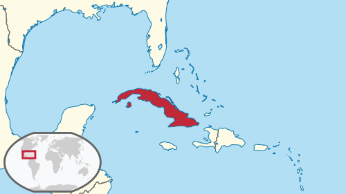
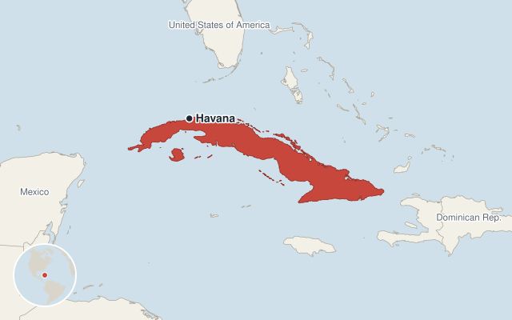

---
id    = "6fd4ac16-b76c-5d42-9064-f0e49b3b0635"
model = "Basic"
tags  = ["caribbean", "north_america", "sovereign_state", "map"]
---

## Front

What is highlighted on this map?

## Back

<b>Cuba</b>

## Extra

Highest point Pico Turquino Where the Caribbean Sea, Gulf of Mexico and Atlantic Ocean meet

It lies east of the Yucatán Peninsula, south of Florida and the Bahamas, west of Hispaniola and north of Jamaica and the Cayman Islands.

<a href="https://en.wikipedia.org/wiki/Cuba">Cuba on Wikipedia</a>
