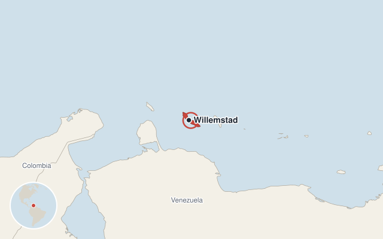

---
id    = "5a30c34a-6d3c-5c24-a549-dd911611baf9"
model = "Basic"
tags  = ["caribbean", "north_america", "capital"]
---

## Front

What is the capital of <b>Curaçao</b>?

## Back

<b>Willemstad</b>

## Extra

Constituent country of the Kingdom of the Netherlands.

<a href="https://en.wikipedia.org/wiki/Willemstad">Willemstad on Wikipedia</a> <a href="https://en.wikipedia.org/wiki/Cura%C3%A7ao">Curaçao on Wikipedia</a>
