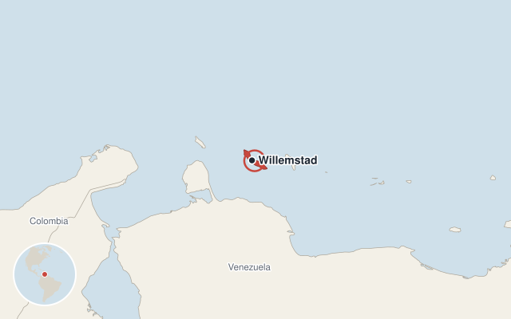

---
id    = "4d59c663-44c6-573d-861e-1d87b7830e4b"
model = "Basic"
tags  = ["caribbean", "north_america", "country"]
---

## Front

<b>Willemstad</b> is the capital of which country or territory?

## Back

<b>Curaçao</b>

## Extra

Constituent country of the Kingdom of the Netherlands.

<a href="https://en.wikipedia.org/wiki/Cura%C3%A7ao">Curaçao on Wikipedia</a> <a href="https://en.wikipedia.org/wiki/Willemstad">Willemstad on Wikipedia</a>
