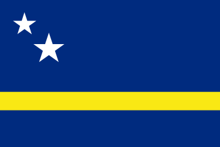

---
id    = "1b9d1e2e-0f1e-5fe9-8962-2a5c88a91751"
model = "Basic"
tags  = ["caribbean", "north_america", "flag"]
---

## Front

Whose flag is this?

## Back

<b>Curaçao</b>

## Extra

Similar flags: Nauru (single star below yellow band)  Constituent country of the Kingdom of the Netherlands.
