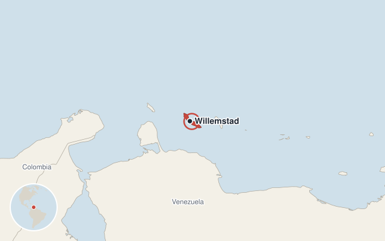
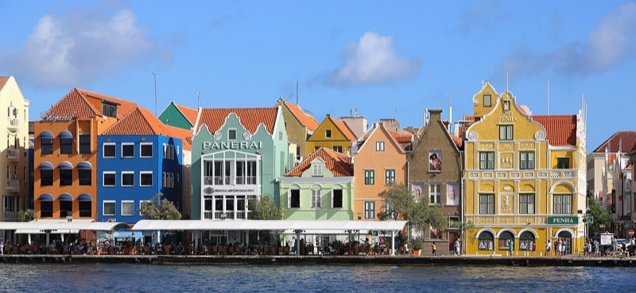

---
id    = "35d94b9c-3f89-5b11-85dc-5239c9d66db4"
model = "Basic"
tags  = ["caribbean", "north_america", "map"]
---

## Front

What is highlighted on this map?

## Back

<b>Curaçao</b>

## Extra

<i>Photo: Martin Falbisoner, Martin Falbisoner, via Wikimedia Commons</i>

Includes the uninhabited island of Klein Curaçao About 80 km southeast of Aruba

The main island and Klein Curaçao, 'Little Curaçao', lie in the southern Caribbean Sea, about 65 km north of Venezuela.

Constituent country of the Kingdom of the Netherlands.

<a href="https://en.wikipedia.org/wiki/Cura%C3%A7ao">Curaçao on Wikipedia</a>
