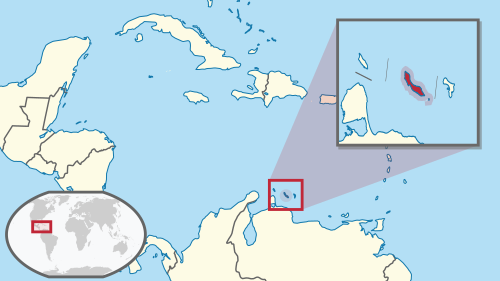

---
id    = "35d94b9c-3f89-5b11-85dc-5239c9d66db4"
model = "Basic"
tags  = ["caribbean", "north_america", "map"]
---

## Front

What is highlighted on this map?

## Back

<b>Curaçao</b>

## Extra

Constituent country of the Kingdom of the Netherlands.
