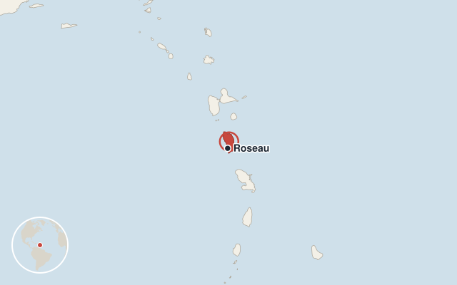

---
id    = "d1a16b0d-4505-5b84-bfa9-e8529e9f54f4"
model = "Basic"
tags  = ["caribbean", "north_america", "sovereign_state", "capital"]
---

## Front

What is the capital of <b>Dominica</b>?

## Back

<b>Roseau</b>

## Extra

<a href="https://en.wikipedia.org/wiki/Roseau">Roseau on Wikipedia</a> <a href="https://en.wikipedia.org/wiki/Dominica">Dominica on Wikipedia</a>
